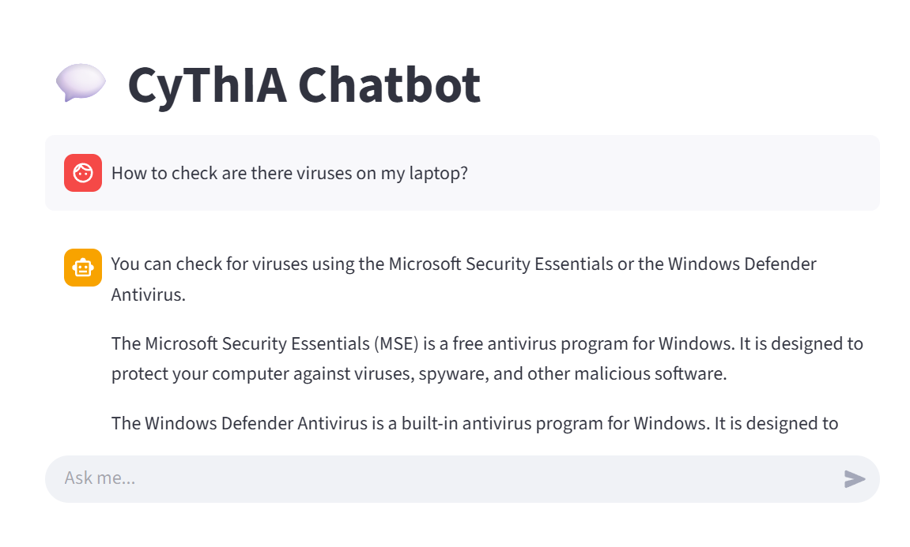
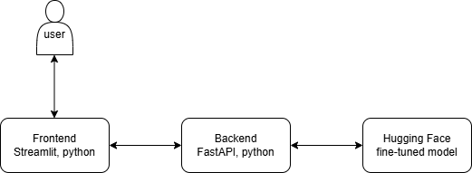

# CyThIA Chatbot – Conversational Cyber Threat Advisor

A working prototype of **CyThIA**, a conversational AI assistant for cybersecurity and cyber threat intelligence questions. The chatbot runs on **CyThIA-Mistral**, a Mistral-7B-Instruct model fine-tuned on cybersecurity Q&A data. It was built for my bachelor's thesis at Oulu University of Applied Sciences, in collaboration with the Future Computing Group, University of Oulu (2026).

This repository covers the **system side** of the project: **chatbot implementation → deployment → evaluation with DeepEval, using an LLM as a judge.**

> ⚠️ CyThIA is an exploratory research prototype. It is **not** intended for real-world security decisions or autonomous operations.

- 💬 **Live demo:** [CyThIA chatbot on Streamlit Cloud](https://chatbotonrunpod-xu7wrjz6yps4jpzerujfvw.streamlit.app/) <!-- only works while the RunPod backend is running -->
- 📄 **Thesis (open access):** [Designing a Conversational Cyber Threat Advisor Using Domain-Tuned Conversational AI](https://urn.fi/URN:NBN:fi:amk-202604015472)
- 🧪 **Model fine-tuning & selection:** [CyThIA](https://github.com/mariiazhivonitko/CyThIA)

<!-- Add a screenshot of the chat interface here (thesis figure 2), e.g. images/chat_screenshot.png -->
<!--  -->

---

## System architecture



The system follows a **modular client-server design**. The user interface, backend logic and model inference are separate components, which keeps the system scalable and easy to deploy.

1. The user sends a question through the **web frontend**.
2. The frontend sends an **HTTP request** with the message to the **backend**.
3. The backend forwards the message to the **fine-tuned LLM**.
4. The model generates a response, and the backend returns it to the frontend.
5. The frontend shows the answer in the chat.

| Component | Technology | Hosting |
|---|---|---|
| Frontend | **Streamlit** chat UI (`frontend/app.py`) | Streamlit Community Cloud |
| Backend | **FastAPI** REST API (`backend/main.py`) | RunPod GPU pod |
| Model | **CyThIA-Mistral** (Mistral-7B-Instruct + LoRA adapter), Hugging Face Transformers pipeline | RunPod GPU pod |

### API

| Method | Endpoint | Description |
|---|---|---|
| `GET` | `/` | Health check |
| `POST` | `/chat/{model_name}` | Send `{"message": "..."}` and get `{"response": "..."}` |

Example:
```bash
curl -X POST https://<your-runpod-url>/chat/CyThIA-Mistral \
     -H "Content-Type: application/json" \
     -d '{"message": "What is a phishing attack?"}'
```

Generation settings: `max_new_tokens=200`, `temperature=0.7`, `top_p=0.9`.

## Evaluation

### Why not BLEU / ROUGE?

Evaluating LLM-based systems is hard:
- **Human evaluation** is the most reliable, but it is slow, expensive and needs cybersecurity experts, so it doesn't scale.
- **Lexical metrics** (BLEU, ROUGE) only measure word overlap with a reference answer. They miss meaning, reasoning and contextual relevance.
- **Semantic similarity metrics** (BERTScore, cosine similarity) are better, but they still depend on reference answers and cannot judge factual correctness, reasoning quality or safety.

These limits matter in cybersecurity, where an incorrect or misleading answer can have serious consequences. *(The traditional metrics were used earlier, to compare and select the fine-tuned models. See [CyThIA](https://github.com/mariiazhivonitko/CyThIA).)*

### Approach

The chatbot was therefore evaluated on **response quality** with two groups of metrics:

1. **Readability metrics**: how easy the generated answers are to read (`evaluation/readability_evaluation.py`).
2. **Conversational quality metrics**: model-based evaluation with **[DeepEval](https://github.com/confident-ai/deepeval)** and its **G-Eval** framework, using an **LLM-as-a-judge** on a cybersecurity test set (`evaluation/cleaned_testdata.csv`).

### Results

**1. Readability**

| Metric | Score | Reading grade | Difficulty |
|---|---|---|---|
| Flesch-Kincaid Grade Level | 7.77 | 8th grade | Medium |
| Flesch Reading Ease | 68.61 | 9th grade | Medium |
| Gunning Fog Index | 10.13 | 10th grade | Medium |
| SMOG Index | 9.56 | 10th grade | Fairly difficult |
| Automated Readability Index (ARI) | 8.06 | 8th grade | Medium |

Most metrics place the answers at about an **8th–10th grade reading level**, which is easy to read for most adult users. SMOG is slightly higher but still acceptable for technical content.

**2. Conversational quality (LLM-as-a-judge)**

| Metric | Framework | Avg. score |
|---|---|---|
| Answer relevancy | DeepEval | **0.79** |
| Correctness | G-Eval (DeepEval) | 0.35 |
| Conciseness | G-Eval (DeepEval) | 0.32 |
| Coherence | G-Eval (DeepEval) | 0.25 |

- **Relevancy (0.79):** the chatbot usually understands the user's intent and stays on topic.
- **Correctness (0.35):** answers can contain factual errors or incomplete reasoning. This is critical in cybersecurity.
- **Conciseness (0.32):** answers often include unnecessary detail or repetition.
- **Coherence (0.25):** longer answers lack logical flow and structure.

**Conclusion:** the chatbot is readable and relevant, but correctness, conciseness and coherence need improvement before any real-world use. That is why CyThIA is presented as an exploratory prototype. The results also show the value of combining several complementary metrics to capture different aspects of quality.

## Repository structure

```
chatbot_on_runpod/
├── frontend/          # Streamlit chat UI (deployed on Streamlit Cloud)
│   ├── app.py
│   └── requirements.txt
├── backend/           # FastAPI service serving the fine-tuned model (runs on RunPod)
│   ├── main.py
│   └── requirements.txt
├── evaluation/        # DeepEval / G-Eval / safety / readability evaluation + test data
├── architecture.png   # system architecture diagram
└── architecture.drawio
```

## How to run

**Backend** (on a GPU machine, e.g. a RunPod pod):
```bash
cd backend
pip install -r requirements.txt
uvicorn main:app --host 0.0.0.0 --port 8000
```

**Frontend** (locally or on Streamlit Cloud):
```bash
cd frontend
pip install -r requirements.txt
streamlit run app.py
```
Set the backend URL in `frontend/app.py` to your RunPod endpoint.

**Evaluation** (needs an OpenAI API key for the judge model):
```bash
export OPENAI_API_KEY=...
cd evaluation
deepeval test run test_deepeval_mychat.py
```

## Tech stack

Python · Streamlit · FastAPI · Hugging Face Transformers · PEFT / LoRA · RunPod (GPU) · DeepEval · G-Eval · LLM-as-a-judge · readability metrics (Flesch-Kincaid, SMOG, ARI, Gunning Fog)

## Acknowledgements

This project was supervised by **Prasasthy K B**, Future Computing Group, University of Oulu.

## Author

**Mariia Zhivonitko** – Data & AI | LLM fine-tuning, evaluation, RAG | Oulu, Finland

[LinkedIn](https://www.linkedin.com/in/mariia-zhivonitko/)
