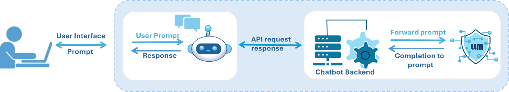

# CyThIA Chatbot – Conversational Cyber Threat Advisor

A prototype chatbot for cybersecurity questions, powered by **CyThIA-Mistral** (Mistral-7B-Instruct-v0.3 fine-tuned with LoRA). Built for my bachelor's thesis at Oulu University of Applied Sciences with the Future Computing Group, University of Oulu (2026).

> ⚠️ Research prototype. Not intended for real-world security decisions.

- 📄 **Thesis:** [Designing a Conversational Cyber Threat Advisor Using Domain-Tuned Conversational AI](https://urn.fi/URN:NBN:fi:amk-202604015472)
- 🧪 **Model fine-tuning & selection:** [CyThIA](https://github.com/mariiazhivonitko/CyThIA)
- 💬 **Demo:** [Streamlit app](https://chatbotonrunpod-xu7wrjz6yps4jpzerujfvw.streamlit.app/) *(backend runs only during testing, so it may be offline)*

<p align="center">
  
</p>

## Architecture



The system has a modular client-server design: a **Streamlit** frontend (Streamlit Cloud) sends the user's message to a **FastAPI** backend (`POST /chat/{model_name}`). The backend runs the fine-tuned model on a **RunPod** GPU and returns the answer.

## Evaluation

BLEU and ROUGE can't judge correctness or reasoning in open-ended answers, so the chatbot was evaluated with **readability metrics** and **LLM-as-a-judge** metrics (DeepEval, G-Eval).

| Readability | Score | Grade |
|---|---|---|
| Flesch-Kincaid | 7.77 | 8th |
| Flesch Reading Ease | 68.61 | 9th |
| Gunning Fog | 10.13 | 10th |
| SMOG | 9.56 | 10th |
| ARI | 8.06 | 8th |

| Conversational quality | Score |
|---|---|
| Answer relevancy | **0.79** |
| Correctness (G-Eval) | 0.35 |
| Conciseness (G-Eval) | 0.32 |
| Coherence (G-Eval) | 0.25 |

Answers are readable (8th–10th grade) and relevant to the question, but correctness, conciseness and coherence need improvement before real-world use.

## Run

```bash
# Backend (GPU machine, e.g. RunPod)
cd backend && pip install -r requirements.txt && uvicorn main:app --host 0.0.0.0 --port 8000

# Frontend (set the backend URL in app.py)
cd frontend && pip install -r requirements.txt && streamlit run app.py

# Evaluation (needs OPENAI_API_KEY for the judge model)
cd evaluation && deepeval test run test_deepeval_mychat.py
```

---

Supervised by **Prasasthy Balasubramanian**, Future Computing Group, University of Oulu.
Author: **Mariia Zhivonitko** · [LinkedIn](https://www.linkedin.com/in/mariia-zhivonitko/)